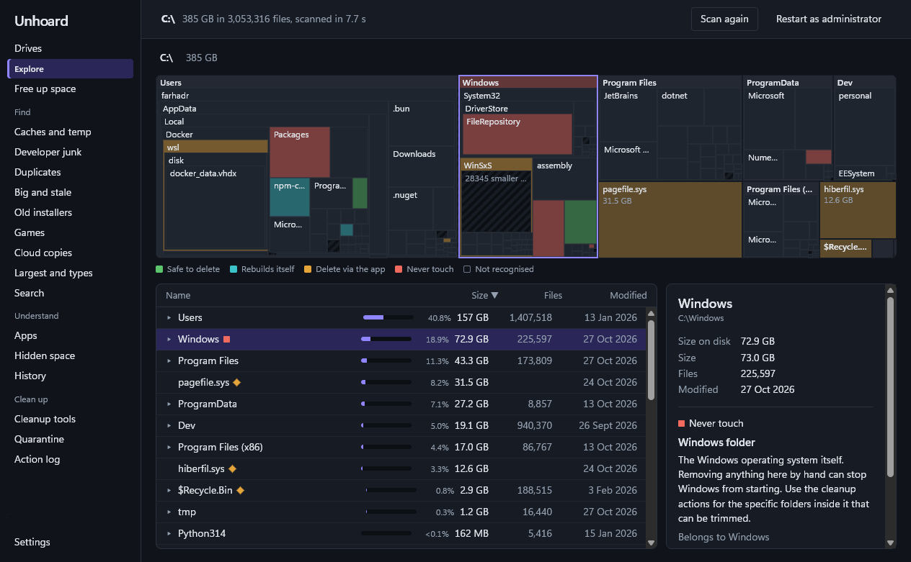
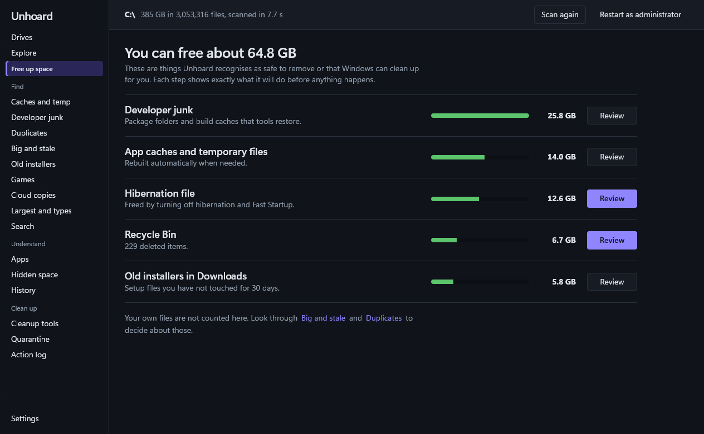

# Unhoard

A free, open-source Windows app that shows where your disk space went, tells you what each space hog is, and helps you get the space back safely.

Most disk tools stop at "this folder is big". Unhoard also answers the questions that come next: what is this, is it safe to delete, and what is the right way to remove it?

Nothing is deleted straight away. Removed items wait in a quarantine for a week and come back with one click, and Windows and program folders can never be removed.

[Download](https://github.com/ridoyf/unhoard/releases/latest) · [How it keeps your files safe](#how-it-keeps-your-files-safe) · [What is this folder, and can I delete it?](https://ridoyf.github.io/unhoard/)



## What it does

- Run as administrator and it reads the NTFS file table directly. Without admin rights it walks the drive in parallel; about 3 million files take under 30 seconds on an SSD.
- The treemap is coloured by safety: safe to delete, rebuilds itself, delete via the app, or never touch.
- About 140 built-in rules recognise common space hogs (browser caches, `node_modules`, WinSxS, the hibernation file, game libraries and more) and explain them in plain English.
- Some things should not just be deleted, so it runs the official tool instead: DISM for the component store, `powercfg` for hibernation, `docker system prune`, WSL disk compaction, the app's own uninstaller, or "make online-only" for OneDrive files.
- It shows the space no file listing shows: restore points, file system metadata, reserved storage, the page file and the Recycle Bin.
- Finders for duplicates, big files nobody has touched in years, old installers in Downloads, developer junk, app caches and games.
- When something cannot be removed, it says why and what to do: which app has the file open, whether administrator rights would help, or which tool removes it properly. Long jobs show live progress and say when they go quiet.
- Every scan is saved, so you can see what grew since last week and how a drive fills up over time.



## How it compares

WinDirStat, WizTree, TreeSize and SpaceSniffer are good at showing where space went, and WizTree is faster on a full drive. None of them tell you what a folder is or the right way to remove it, so you are left searching "can I delete WinSxS?". Unhoard is built around that question. If you only want a fast picture of a drive, WizTree is a fine choice; if you want to know what you can safely clear, use Unhoard.

## How it keeps your files safe

Unhoard deletes files on real machines, so every removal goes through these rules, enforced in the backend rather than just the UI:

1. **Nothing is deleted straight away.** Removed items are moved to a quarantine on the same drive and can be restored with one click. They are deleted for good after 7 days (you can change this) or when you empty the quarantine.
2. **Protected locations can never be removed:** Windows, the Program Files and ProgramData folders, user profiles and their standard folders, drive roots, system files such as `pagefile.sys`, and anything a rule marks "never touch". The check also sees through `..`, 8.3 short names (`PROGRA~1`) and junctions that point somewhere protected.
3. **You see every action first.** Each cleanup action shows exactly which commands it will run and roughly how much it frees, and does nothing until you confirm.
4. **Everything is logged.** The action log records what was moved, restored, deleted or run, and what failed.
5. **When unsure, the answer is no.** Anything Unhoard does not recognise is shown as "not recognised", and rules default to "never touch".

Unhoard runs entirely on your PC. There is no account and no telemetry. The only network request is an optional check for a new version on GitHub, which you can turn off in Settings.

## Install

Download the latest installer from [Releases](https://github.com/ridoyf/unhoard/releases) and run it. Windows 10 or 11 (x64) is required. The WebView2 runtime is already part of Windows 11; the installer adds it on Windows 10 if needed.

The installer is not code-signed yet, so Windows SmartScreen may warn you the first time. Choose **More info**, then **Run anyway**.

Every release is built by GitHub Actions from the tagged source. From v0.2.0 the release page links to the build log, and with the [GitHub CLI](https://cli.github.com) you can check that a download is the file that build produced:

```
gh attestation verify unhoard-amd64-installer.exe --repo ridoyf/unhoard
```

## Build from source

You need Go, Node.js and the Wails v3 CLI:

```
go install github.com/wailsapp/wails/v3/cmd/wails3@v3.0.0
wails3 dev                      # run with hot reload
wails3 build                    # bin/unhoard.exe
wails3 package VERSION=v0.1.0   # installer in bin/ (needs NSIS)
go test ./...                   # Go tests
```

On a fresh clone, build the frontend once (`wails3 build`, or `npm run build` in `frontend`) before running `go test`, because the app embeds `frontend/dist`.

## Adding rules

Rules live in [`rules/`](rules), one YAML file per category. Anything Unhoard does not recognise has a **Suggest a rule for this** link that opens a pre-filled issue, so you do not need to write YAML to help. Each rule carries its own test cases, and `go test ./internal/kb/` checks every one. You can also drop YAML files into `%LOCALAPPDATA%\Unhoard\rules` to override built-in rules by id without rebuilding.

## Contributing

Bug reports, new rules and pull requests are welcome. See [CONTRIBUTING.md](CONTRIBUTING.md).

## Licence

MIT. See [LICENSE](LICENSE).
